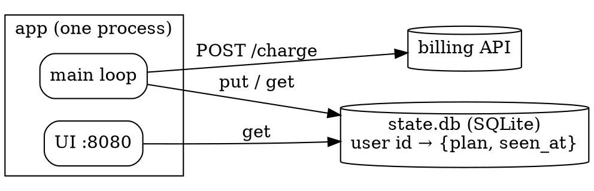

# OVERVIEW.md (soulreap map v10)

The one file a reader opens first. The first `plan` scaffolds it; from then on `render`
rewrites the five generated blocks and adds a line span after each anchor, a basis line
under each section and a stale banner where the code moved — so re-read it before editing.
Everything else is prose the reader wrote.

## Sections, in order

| section | written by | content |
|---|---|---|
| title + `stamp` block | render | commit, file and line counts, date |
| What this is | reader | purpose, callers, where it runs |
| How it runs | reader + `diagrams/architecture.dot` | every entry point as `[[file::symbol]]` and what it starts; the runtime picture (below) |
| Where things are | `inventory` block + reader | generated layout and non-code inventory, then one line per area that matters |
| State and data | `diagrams` block + reader | context picture and one ERD per database (`diagrams/erd-<database>.svg`), then who stores and writes what |
| Sharp edges | `verdicts` block + reader | generated findings (cycles, unread schema, stale sections), then the traps |
| Not covered | `coverage` block + reader | what the run read, what it did not, uncited checklist items, then reasons |

## Rules

* Never hand-edit between `<!-- soulreap:NAME -->` and `<!-- /soulreap:NAME -->`. A block
  dropped from this skill's OVERVIEW is put back under its heading (`overview_restored`).
* An OVERVIEW without those markers (an older map, v9 or earlier) is never rewritten; render
  reports which blocks are missing (`overview_missing`). Report it — the user decides whether
  to delete it for a fresh scaffold.
* Prose cites code as `[[file::Symbol]]`; render keeps line spans live and adds a basis
  line per section, so a section that went stale says so under its heading.

## The runtime picture — `diagrams/architecture.dot`

The one diagram no parser can draw: imports say who references whom inside a process, never
how the running pieces talk. Write it in Graphviz dot (≤ 40 lines); `render` draws it and
pastes it first in the diagrams block. Skip it only for a library with nothing running.

* **Nodes:** each process or thread the entry points start (with its port), each store with
  its key and file (`state.db` — user id → {plan, seen_at}), each config file, each
  outside system with the endpoints called (`POST /charge`).
* **Edges:** labelled with what crosses them — `GET /users`, `re-read each cycle`,
  `put / pop`. Group one process's threads in a `subgraph cluster_…`.
* **Source:** the packet's `What runs`, `State outside the process` and the context diagram,
  plus what you already read — never re-read code for it.

