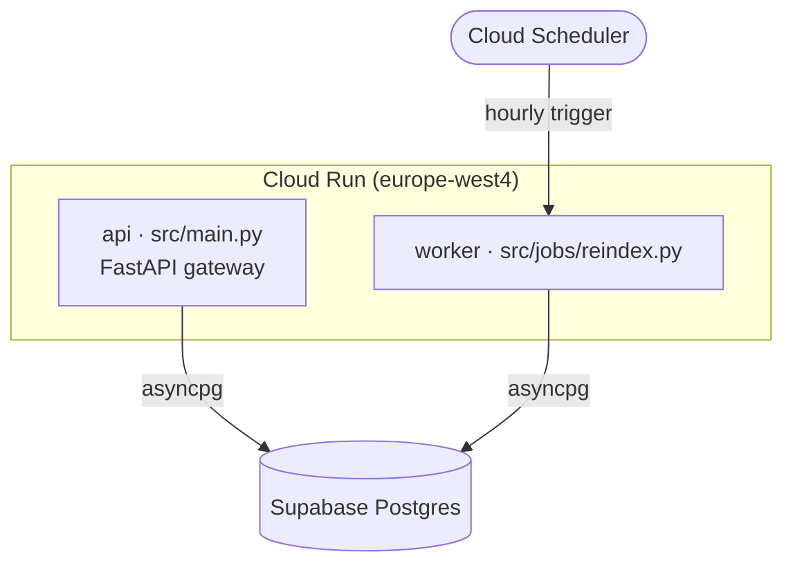
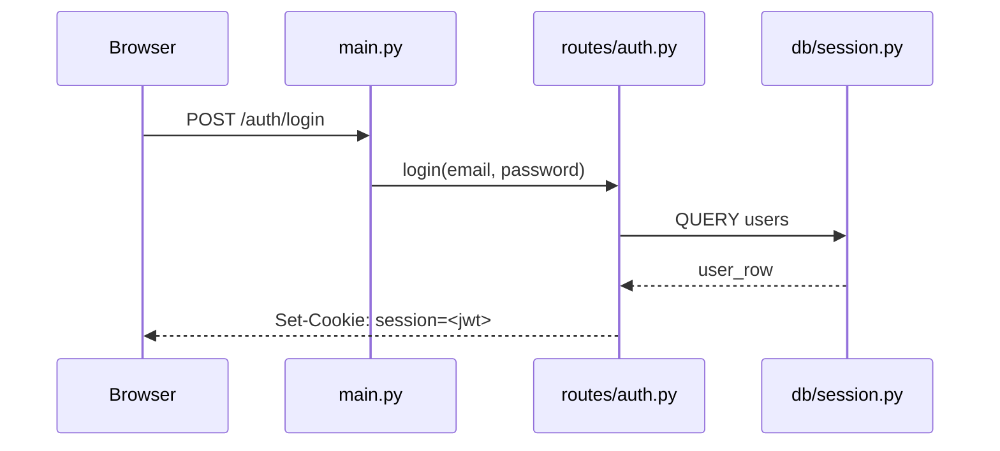

# OVERVIEW.md template

Written last, to `soulreap/OVERVIEW.md`, once every card exists. Its inputs are
`plan.json` (tree, non-code inventory, secrets, cycles) and `INDEX.md` (the role
line of every file). Do not re-read source files to write it.

```markdown
# <project name>

`<commit>` · <n> source files · <n> lines · generated <date>

## What this is

Three to five sentences. What the system does, who uses it, where it runs.
Say it the way you would to a new hire on their first morning.

## Stack

| Layer | Choice | Version | Where it is pinned |
| --- | --- | --- | --- |
| Runtime | Python | 3.12 | `pyproject.toml` |
| Web | FastAPI | 0.115 | `pyproject.toml` |
| Database | Supabase Postgres via asyncpg | — | `src/db/session.py` |
| Deploy | Cloud Run, europe-west4 | — | `.github/workflows/deploy.yml` |

## Entry points

| Entry | File | Trigger |
| --- | --- | --- |
| HTTP API | `src/main.py` | `uvicorn src.main:app` |
| Worker | `src/jobs/reindex.py` | Cloud Scheduler, hourly |
| CLI | `scripts/backfill.py` | manual |

## Layout

```
src/
  api/        HTTP routes, one module per resource      (12 files, 1.4k lines)
  db/         asyncpg pool, session helper, migrations   (4 files, 380 lines)
  models/     Pydantic schemas shared by API and jobs    (7 files, 520 lines)
  jobs/       Background workers, no HTTP surface        (3 files, 610 lines)
tests/        pytest, mirrors src/                       (18 files, 2.1k lines)
```

One line per directory, saying what belongs there and what does not.

## Non-code inventory

- **CI:** `.github/workflows/{ci,deploy}.yml` — lint and test on PR, deploy on main
- **Containers:** `Dockerfile` (distroless, non-root), `docker-compose.yml` for local Postgres
- **Infrastructure:** `infra/live/{dev,stage,prod}/` — Terragrunt, one stack per environment
- **Migrations:** `migrations/versions/` — 14 Alembic revisions, head `a3f9c2`
- **Config keys:** `.env.example` declares `DATABASE_URL`, `JWT_SECRET`, `GOOGLE_CLIENT_ID` (names only)

## What it talks to

Paste `soulreap/diagrams/context.mmd`, then one sentence naming what the reader should
notice — the surprising dependency, the service nobody documented, the thing that will be
down at 3am.

```mermaid
<paste soulreap/diagrams/context.mmd>
```

## Architecture

**Required when the system is more than one process.** A component/topology diagram of the
runtime pieces — services, workers, datastores, queues, the external boundary — and how they
are wired (queue / HTTP / exec / driver), *not* files and *not* imports. Save it as
`soulreap/diagrams/architecture.mmd` (same folder as the rest) and paste it here, then one
sentence on the shape: the single spine, the part that runs host-side only, the thing that
degrades when a dependency is down. Source it from `docker-compose.yml`, the Entry points
table, the deploy notes on the cards and `context.mmd` — never by re-reading source. No parser
produces it: imports say who references whom inside one process, never how the deployed pieces
talk. `render` lints it but never writes it. Skip this section (and say so) for a single-process
library or CLI that has no topology to draw.



Import coupling is **not** pasted as its own section — `Architecture` above is the runtime
view a reader wants, and a second boxes-and-arrows picture of import counts reads as a rival
architecture diagram and gets skipped. `render` still writes `soulreap/diagrams/packages.mmd`
for anyone who wants the layering picture, and prints a one-line verdict — put that verdict
(node count, density, any real layering violation) as a single bullet under Sharp edges, not
as a diagram.

## The main path

**Required.** A sequence diagram of the one flow that matters most, written from the cards.
Save it as `soulreap/diagrams/flow.mmd` — same folder as the generated two, so the diagram
folder is complete — then paste it here. `render` never touches that file; it only reports
whether it exists. No parser can produce it: dependency edges say who imports whom, never
what happens in what order.



## Running it

```bash
uv sync
docker compose up -d postgres
uv run alembic upgrade head
uv run uvicorn src.main:app --reload
```

## Sharp edges

- `src/jobs/reindex.py` and `src/db/pool.py` import each other — circular, breaks on reorder.
- Password comparison lives only in `src/api/routes/auth.py`; change it nowhere else.
- Coupling (from `packages.mmd`): 6 packages, density 20%, flat — `api` ↔ `db` is a tight
  mutual pair. Quote `render`'s verdict; do not invent a nicer one.
- 3 files fail to parse and have no cards: listed at the bottom of INDEX.md.
```

## Rules

- Secrets: key names only, never values. `plan.json` already redacts them; keep it that way.
- Every diagram gets a sentence saying what to look for. A diagram with no question is the
  one readers skip; that is the whole reason the old per-file graph was dropped.
- Three diagrams get pasted, one per question: `context.mmd` (external boundary),
  `architecture.mmd` (runtime topology), `flow.mmd` (one request over time). Do not restate
  one in another. Skip architecture only when the system genuinely is one process, and say
  why. `packages.mmd` (import coupling) is generated but not pasted — it becomes the one-line
  coupling bullet under Sharp edges.
- A dotted edge in `packages.mmd` is a grouping artifact, not a cycle. Do not report it as
  one; `plan.json.cycles` is the only authority on real import cycles.
- `context.mmd` only sees literals — a service reached through a config value shows up as
  nothing. Say so if you know of one that is missing.
- Import cycles from `plan.json` go under Sharp edges. They are the fastest way to make a
  reader distrust the layout, so name them.
- The layout section counts come from `plan.json.tree`. Do not estimate them.
- If something is unknown — no README, no obvious entry point — write "unknown" and move on.
  A confident wrong answer here poisons every reader after you.
